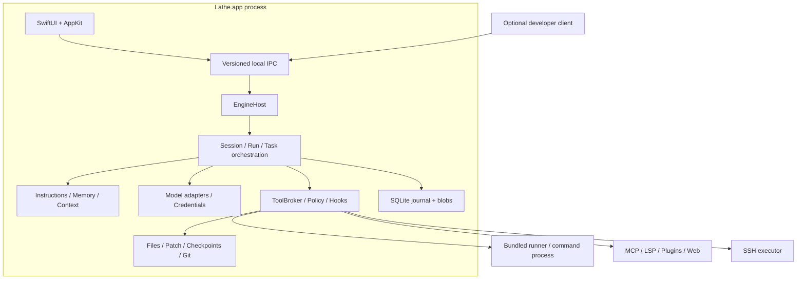

# Lathe 상세 아키텍처

설계 기준일: 2026-10-15. 상태: **목표 아키텍처, M0 기반·M1 첫 코딩 흐름 구현**. 목표는 Swift 네이티브 macOS 앱에서 Claude Code와 동등한 작업 흐름을 제공하고 여러 모델 프로바이더를 선택하는 것이다.

현재 `Lathe.app` 프로세스 안의 `EngineHost`가 `EngineRuntime` actor·SQLite writer·모델 연결과
도구 실행을 소유한다. 앱과 선택적인 개발 client는 1 MiB framed JSON-RPC·cursor polling으로 상태를 공유한다. `LatheProviders`의 Responses/Chat
adapter, `LatheTools`의 broker/정책과 네 파일·명령 도구, `LatheExecution` 및 별도 `lathe-runner`,
내용 주소 기반 blob 저장소를 연결했다. 승인·변경 전 내용·결과 참조를 effect 전에/후에 기록하고
재시작 후 불명확한 실행을 자동 replay하지 않는다. 기본 선택은 mock이다.

아래의 세부 coordinator, Hooks/MCP, Ultra, production sandbox, 편집기·디버거는 목표 구조다.
현재 PolicyEngine은 `LatheTools` 안의 작은 구현이며 UI가 executor를 직접 호출하지 않는다.
실제 구현과 검증 범위는 [첫 코딩 흐름](coding-preview.md), [개발 가이드](development.md),
[실행 helper](runner.md)에 기록한다. Live provider 검증과 M1 전체 완료는 별도 게이트다.

## 1. 기준과 문서 경계

- [기능 정의](features.md): 관찰 가능한 기능, 완료 기준, 공식 근거.
- [확장 호환 계약](extensions.md): 설정·지침·Skills·Hooks·MCP·plugins·LSP.
- [프로바이더 계약](providers.md): 서비스별 API, 인증, 외부 모델 서버.
- [추론과 Ultra](reasoning-and-ultra.md): native 옵션, Off/On/Ultra, 역할·공유 예산·서버 큐.
- [도구와 MCP 설치](tools-and-mcp-setup.md): 검색·도구 registry, 기존 MCP 설치·설정·검증·적용.
- [실행·디버깅](execution-and-debugging.md): 실행 profile·환경·테스트 증거·LLDB-DAP.
- [기능 누락 점검](functional-gap-audit.md): 기준 revision 대비 보완 항목과 우선순위.
- [구현 계획](roadmap.md): 단계별 기능/커밋/검증 게이트.

첫 milestone은 전체 기능 동등성의 완료가 아니다. Skills·Hooks·MCP·서브에이전트·체크포인트와 앱 수명 안의 백그라운드 작업은 최종 제품의 필수 기능이다.
CLI/독립 engine은 개발·검증 harness이며 별도 설치 제품이나 앱 종료 뒤의 상주 서비스가 아니다.
공식 CLI와 Desktop도 기능 가용성이 다르므로 기준일·표면·조건을 기능별로 기록한다. 외부 서비스 기능과 실험 기능도 별도 요구사항으로 추적한다.
같은 작업·설정 계약을 제공하더라도 선택 모델의 판단·코드 품질·성공률까지 동일하다고 보장하지 않는다.

## 2. 핵심 결정

| 결정 | 제안과 이유 |
| --- | --- |
| 실행 코어 | Swift 자체 구현. 특정 Claude 실행 파일이나 특정 제공자 Agent SDK를 필수 코어로 사용하지 않음 |
| UI | SwiftUI + AppKit. 대화·설정은 SwiftUI, 긴 코드/로그/diff/PTY는 AppKit 컴포넌트 |
| OS/언어 | macOS 15 이상 제안, Swift 6 언어 모드. 최신 SDK 빌드와 최소 OS 검증은 별도 |
| 빌드 | Xcode 앱 target + 하나의 로컬 Swift Package |
| 수명 | 앱 프로세스가 runtime 소유. 진행 중 종료는 중단/앱 유지/취소 선택, 미완료 작업 없는 마지막 창 닫기는 종료. 별도 daemon 없음 |
| 저장 | SQLite WAL + 단일 writer actor, 출력·변경 전 내용·context는 SHA-256 blob. retention/복원은 후속 |
| 모델 | API 어댑터·인증·capability 분리. 외부 vLLM/Ollama도 동일한 연결 모델 |
| 추론·Ultra | provider 추론 제어와 다중 agent 실행을 분리. 로컬 모드 Off/On/Ultra는 검증된 두 축의 preset |
| 검색·MCP | 모델과 독립적인 integration. 사용자가 맡긴 scope 안에서 사용자 문서 링크를 읽고 기존 MCP 설치·설정·검증·적용을 선택한 권한 모드로 진행 |
| Git | 시스템 git. GitHub는 준비된 gh 또는 별도 connector. 인수 배열·명시적 cwd 사용 |
| 격리 | 승인 정책과 OS sandbox backend 분리. 검증 전에는 격리 완료로 표시하지 않음 |
| 배포 | 개인 사용·GitHub 소스 제공. 바이너리 배포 시 서명/공증 |

`ModelConnection`, `ExecutionEnvironment`, `IntegrationService`를 독립 축으로 둔다.
외부 vLLM + Mac 프로젝트, OpenAI + SSH 프로젝트, Mac Ollama + Mac 프로젝트를 같은 런타임이 다룬다.
원격 모델 endpoint를 등록하는 행위는 그 서버에서 파일이나 shell을 실행할 권한을 만들지 않는다.

## 3. 프로세스와 수명



- `EngineHost`는 앱 안에서 runtime·DB writer·IPC listener를 시작하고 종료한다. handshake PID는 앱 PID다.
- 앱이 독점 lifetime lease를 얻은 뒤 DB를 연다. 같은 root를 소유한 다른 프로세스가 있으면 attach하지 않고 충돌로 표시한다.
- migration도 독점 lease 아래 수행한다. stale socket은 이전 owner가 없음을 확인한 뒤 정리한다.
- 기본 IPC는 사용자 전용 Unix domain socket + 길이 프레이밍한 JSON-RPC 2.0이다. 경로 길이·디렉터리 권한·peer UID를 검증한다.
- 이 IPC 인증을 같은 사용자 권한의 악성 프로세스에 대한 OS 격리로 주장하지 않는다.
- request/session/run ID, protocol version, event cursor를 전달한다. UI·개발 client는 file tool을 직접 우회 호출하지 않는다.
- 진행 중 작업이나 미전송 입력이 있을 때 마지막 작업 창 닫기·종료는 중단 후 종료, 백그라운드 유지, 취소 중 선택한다. 미완료 작업이 없으면 바로 종료한다.
  백그라운드에서는 앱 프로세스가 계속 실행되고 메뉴 막대에서 다시 열거나 종료한다. 별도 daemon으로 작업을 넘기지 않는다.
- 앱 종료는 새 요청 수락을 멈추고 모델·runner를 취소/정리한 뒤 socket과 lease를 해제한다. 저장된 이력은 다음 실행에서 복원한다.
- `Lathe.app`만 배포하며 runner는 번들 내부 실행 helper다. 로그인 agent나 시스템 CLI를 설치하지 않는다.
  앱 삭제와 사용자 세션/Keychain 데이터 삭제를 혼동하지 않는다.
- CLI는 opt-in 개발 빌드에서만 제공하며 기본은 실행 중인 앱에 attach한다. 독립 engine은
  `--developer-engine /absolute/binary --root /absolute/test/data`로 명시한 테스트 harness에서만 시작한다.

| Actor | 소유 상태 |
| --- | --- |
| `EngineCoordinator` | client 접속, 세션/환경 registry, 전역 예산 |
| `SessionActor` | 대화 revision, fork, 입력 mailbox, active run lease |
| `RunCoordinator` | 모델→도구→검증 루프, retry/compaction/steering |
| `UltraCoordinator` | 역할 DAG, child 결과 인계·독립 검토·수정 반복. 실행은 RunCoordinator/TaskSupervisor에 위임 |
| `EndpointScheduler` | serving resource별 요청 lease·공정 큐·부하 제한, coordinator/child 요청 합산 |
| `TaskSupervisor` | shell·subagent·workflow·monitor의 수명과 취소 |
| `WorkspaceCoordinator` | canonical root, write lease, 변경 감지, checkpoint |
| `ExecutionProfileService` | profile·환경 snapshot·bootstrap DAG·build/test receipt; 실행은 공통 broker/runner |
| `DebugSessionActor` | DAP 상태·target identity·control owner·stop generation, adapter process 수명 |
| `DocumentCoordinator` | 열린 문서·dirty buffer revision·복구 blob·agent patch와 editor 변경 조정 |
| `PolicyEngine` | 유효 규칙, approval scope, policy revision |
| `CredentialBroker` | Keychain, helper/OAuth token 갱신 및 합치기 |
| `StoreActor` | 트랜잭션, event sequence, 조회 projection, migration |

UI projection만 `@MainActor`다. actor가 await 후 재진입할 때 run generation·lease·policy revision을 다시 확인한다.

## 4. 모듈과 의존성

```text
Apps/Lathe/                    # Xcode app / native presentation
Packages/LatheKit/
  Sources/LatheDomain/          # IDs, events, effects, protocols
  Sources/LatheRuntime/         # session, run, task, workflow, schedules
  Sources/LatheContext/         # instructions, memory, compilation
  Sources/LathePolicy/          # permission modes, trust, matching
  Sources/LatheProviders/       # API codecs, transport, auth strategies
  Sources/LatheTools/           # registry, broker, file/git contracts
  Sources/LatheExecution/       # process, PTY, sandbox, local/SSH
  Sources/LatheExtensions/      # compatibility, skills/hooks/MCP/plugins/LSP
  Sources/LathePersistence/     # SQLite, blobs, migration, journal
  Sources/LatheProtocol/        # IPC schemas and client
  Sources/LatheEngineHost/      # app-owned runtime / IPC lifecycle
  Sources/LatheEngine/          # opt-in standalone development harness
  Sources/LatheCLI/             # optional developer client / arguments and output
  Sources/LatheRunner/          # executable / process supervision
  Tests/                       # fixtures and behavioral contracts
```

이는 논리 경계다. M0에서 Domain/Runtime/Protocol과 필요한 구현부터 만들고 해당 단계에 target을 추가한다.
Domain은 Foundation 중심의 Sendable value types/protocol만 가지며 SwiftUI·HTTP DTO·SQLite에 의존하지 않는다.
Runtime은 Domain port를 호출하고 앱 안의 EngineHost가 구현을 주입한다. Extensions는 등록/결정만 제공하며 실행 권한을 직접 발급하지 않는다.
App은 EngineHost 수명과 Protocol client를 소유하며 개발 CLI는 Protocol client에 의존한다. provider별 분기를 UI나 agent loop에 넣지 않는다.

## 5. 도메인 모델

| 엔터티 | 필드와 불변식 |
| --- | --- |
| Workspace | id, environmentID, root catalog/default primary root, 모든 세션에 적용되는 policy revision |
| WorkspaceRoot | id, canonical path, repository/worktree ID, read/write scope, instruction/trust revision |
| Session | id, workspaceID, workspaceBindingID, title, parent session/revision, instruction profile |
| SessionWorkspaceBinding | session별 active root IDs·primary root·cwd·access snapshot/revision. fork는 독립 복사하며 전역 deny를 초과하지 못함 |
| Turn | 사용자 입력 경계, checkpointID, typed attachments, 입력 출처 |
| Run | turnID, attempt, model/permission snapshot, budget, state |
| ReasoningPolicy | UI preset, provider native options, capability revision, 요청별 resolved control |
| UltraPlan | root run, role DAG, role model map, child budgets, concurrency, iteration limit |
| ServingResource | connection ID 묶음, capacity profile, queue policy. URL/모델 이름과 별개 |
| ModelStep | request ID, provider snapshot, completion reason, continuation reference |
| ToolInvocation | invocation ID, provider call mapping, tool ID, args hash, effects, state |
| ApprovalGrant | request hash, scope, workspace/connection, policy revision, expiry |
| Task | parent/root ID, kind, environment, state, 예산 예약 |
| ExecutionAttempt | profile/environment/source revisions, actual argv/cwd, artifact/result receipts |
| DebugSession | target identity, adapter/capability revision, launch/attach, owner, stoppedGeneration |
| DocumentBuffer | client/document/root ID, base/disk/buffer revision, dirty snapshot, undo provenance |
| Checkpoint | turn/revision, file manifests, baseline blobs, 변경 소유자 |
| ProviderContinuation | connection/model/API identity, opaque blocks, replay constraints |
| MemoryEntry | scope, source, text, 사용자에게 보이는 revision |
| ExtensionInstall | source/version/hash, scope, declared effects, compatibility report |
| ExtensionChangePlan | 문서/source revision, 기존 서버 설치·config diff, runtime/dependency/network/effects, 검증 결과, 활성 revision |
| ExtensionChangeAuthorization | 사용자 출처 ApprovalGrant의 scoped subtype. plan 범위·만료·철회·policy revision; agent가 발급 불가 |
| Schedule | trigger/timezone, workspace, overlap/misfire policy, enabled |

MessagePart는 text/attachment/tool-call/tool-result/summary를 구분한다. tool result는 call ID와 연결한다.
provider 서명은 canonical 대화와 별도로 보존한다. agent 메시지·webhook·tool output·사용자 입력을 구분하고 외부 입력을 사용자 승인으로 승격하지 않는다.

## 6. 상태와 중간 입력

```text
queued -> preparing -> streaming -> evaluatingTools
                         |                |
                         |                +-> awaitingApproval -> executingTools
                         |                                       |
                         +<------------- feedingResults <---------+
                         +-> completed

active -> cancelling -> cancelled
safe boundary -> awaitingInput / compacting / retryWaiting
active -> failed / interrupted / needsReconciliation
```

세션에는 active run이 하나다. side chat/child session은 고유 run을 갖는다.
추가 지시는 mailbox에 기록하고 도착/반영 event를 분리한다. 기본은 현재 model step/도구 결과의 안전한 경계에서 반영한다.
즉시 중단은 HTTP와 실행 작업을 취소한다. 적용한 파일을 자동 롤백하지 않고 checkpoint 선택을 제공한다.
mid-stream steering 미지원 provider는 중단 후 새 step에서 지시를 반영한다. 계획 승인도 명시적 사용자 command이며 모델이 승인하지 못한다.

HTTP 재요청과 tool 재실행은 다르다. 완료된 tool 결과는 다시 전송할 수 있지만 도구 자체를 재실행하지 않는다.
새 call ID로 같은 변경이 제안되면 파일 precondition·실행 상태를 확인한다. shell/MCP 외부 효과에 exactly-once를 주장하지 않는다.
토큰 한도·취소·비정상 EOF에서 미완성 tool call을 실행하지 않는다.
provider 응답 종료는 final/clientTools/serverContinuation/blocked/truncated/noUsableOutput으로 구분한다.
serverContinuation은 공급자 원본 state를 유지한 다음 model step이며 root 예산·취소·변경 지시 경계가 적용된다.
hosted tool을 로컬 도구로 재실행하지 않고 blocked/empty를 성공으로 기록하지 않는다. [provider 계약](providers.md)이 mapping을 소유한다.

## 7. ToolBroker 계약

모든 built-in/MCP/subagent 도구 호출은 같은 broker를 통과한다.

1. registry의 ToolID/schema revision, 인수·출처·scope를 검증한다.
2. 명백한 hard deny와 취소 상태를 확인한다.
3. PreToolUse hook을 실행한다. 변경된 인수는 새 후보로 취급한다.
4. schema/path/environment/effect를 재검증하고 최종 정책을 계산한다.
5. 승인은 최종 args hash·환경·policy revision에 묶는다. 상태가 바뀌면 재평가한다.
6. write lease/file precondition을 확보하고 intent/checkpoint 참조를 durable 저장한다.
7. executor에서 실행하고 progress·취소·timeout을 처리한다.
8. 결과/change manifest를 저장하고 완료 receipt를 발급한다.
9. 결과 저장 후 부모 write lease를 해제하고 post/failure hook을 실행한다. hook의 쓰기는 새 lease를 얻는다. post hook 실패는 기존 효과를 미실행으로 바꾸지 않는다.

ToolDescriptor는 stable ID, compatibility alias, schema, effect/concurrency class, 취소/timeout,
출력 한도, idempotency 설명, 지원 environment를 갖는다. 내부 `workspace.read`와 호환명 `Read`의 이름·인수를 adapter가 변환한다.
MCP의 readOnly annotation은 참고 정보이며 권한의 증거가 아니다.
모든 hook 실행은 origin과 invocation stack을 갖는다. hook의 내부 실행에도 정책·journal·sandbox를 적용하되 현재 stack의 같은 hook/lifecycle 재발행을 차단한다.
다른 hook을 유발하는 체인도 깊이·횟수 한도를 적용한다. hook을 기다리면서 부모의 workspace write lease를 잡아두지 않는다.
읽기는 bounded parallel, 파일 쓰기·shell·Git mutation은 같은 workspace의 write lane에서 직렬화한다.
장기 서버도 파일을 바꿀 수 있으므로 별도 concurrent task 전환 시 격리/충돌 정책을 적용한다. 병렬 코딩 writer는 worktree를 사용한다.

### 실행 profile·테스트·디버거

ExecutionProfileService와 bootstrap은 composite orchestration으로 parent intent를 기록한다. 전체 흐름의 write lease를
잡고 child build/setup tool을 기다리지 않으며 실제 leaf마다 broker의 lease·policy·journal을 적용한다.
toolchain/PATH/SDK·profile·source snapshot을 ExecutionAttempt에 묶고 raw log와 구조화 BuildResult/TestRun을 보존한다.
0 tests·취소·부분 결과·이전 artifact는 현재 revision의 성공과 구분한다. worktree 준비 실패는 coding task ready가 아니다.

DebugSessionActor는 LatheExecution의 adapter port와 runner를 사용한다. DAP는 별도 protocol이며 Runtime에는 typed
launch/attach/breakpoint/step/inspect/evaluate 결과만 전달한다. adapter의 runInTerminal 역호출도 broker로 보낸다.
launch/attach handshake도 composite orchestration이다. 부모 workspace write lease 없이 DAP event pump를 유지하고
initialized/configurationDone 및 허가된 runInTerminal leaf를 처리한다. launch 응답을 기다리느라 adapter가 요구하는
후속 요청·역호출을 막지 않는다. leaf process 시작의 lease는 그 receipt 후 해제하며 handshake 전체로 연장하지 않는다.
control owner는 하나이며 stoppedGeneration 변경 후 낡은 frame/variable reference를 거절한다.
debugger 전체 수명 동안 workspace write lease를 잡지 않는다. 실행 중 debuggee의 파일 효과는 process sandbox/별도
scratch·checkout 정책으로 관리하고, adapter request 종료만으로 debuggee의 쓰기가 끝났다고 보지 않는다.
owned launch와 external attach는 종료 책임을 분리한다. crash 뒤 PID만으로 재attach하거나 evaluate를 replay하지 않는다.
상세 capability·계획 작업 경계·종료 정책은 [실행·디버깅 계약](execution-and-debugging.md)을 따른다.

## 8. 권한·신뢰·격리

| 모드 | Lathe 동작 계약 |
| --- | --- |
| `fullAccess` | 사용자 요청 범위의 읽기·쓰기·실행을 추가 승인 없이 진행. 입력/경로 검증·OS 권한·한도·기록 유지 |
| `autoApprove` | 낮은 위험으로 분류한 호출만 자동 실행. 나머지와 분류 불명확 호출은 승인 |
| `acceptEdits` | workspace 읽기·구조화된 파일 쓰기는 자동 실행, 명령 실행은 승인 |
| `requestApproval` | 읽기·목록·쓰기·명령 실행 모두 사전 승인. 기본값 |

첫 Auto 분류기는 일반 소스/문서 경로와 좁은 정확한 executable/argv 허용 목록을 사용한다.
숨김·설정·자격 증명·실행 관련·분류 불명확 경로와 나머지 명령은 승인한다. 자유형 AI reviewer가 아니다.
모드별 승인 여부보다 먼저 도구 검증·강제 제한을 적용한다. `fullAccess`도 유효하지 않은 경로나 입력,
OS 권한 거절을 우회하지 않는다. 프로젝트·문서·MCP 출력은 모드나 grant를 바꿀 수 없다.
복합 shell/substitution/redirect를 단순 prefix만으로 낮은 위험이라고 분류하지 않는다.
grant는 once/session/workspace 범위이며 바뀐 args/target/policy에 재사용하지 않는다.
headless에 응답 client가 없으면 needsApproval/needsInput 결과로 종료하며 자동으로 fullAccess를 선택하지 않는다.
계획 작업은 권한 모드가 아니다. 기존 `manual`/`plan`/`dontAsk` 기록은 읽을 때 `requestApproval`로
변환하되 자동 실행하지 않고, 새 실행은 네 모드만 저장한다.

workspace 시작 순서는 discovery → 수동적 parse/검증 → trust/activation → executable startup이다.
SessionStart/Setup hook, skill 전처리, 프로젝트 helper/MCP는 검증된 실행 허가 전 시작하지 않는다.
기존 MCP 설치/시험은 기존 ExtensionChangeAuthorization을 재검사해 제한된 staging 인스턴스를 임시 허가할 수 있다.
이는 영속 registry 활성화와 별개이며 해당 시험 run 밖에 도구를 노출하지 않고 종료/취소 때 회수한다.
agent/hook/shell의 실행 설정 변경은 먼저 pending revision이다. 사용자 출처의 `ExtensionChangeAuthorization` 안에서
검증된 정확한 revision은 PolicyEngine 재검사 후 자동 활성화할 수 있다. grant는 설정 경로·runtime/dependency·
접속 대상·도구 효과·시간/예산 범위를 고정하며, 사용자가 맡긴 기존 MCP 설치/설정은 이 범위 안에서 계속 진행한다.
기존 grant를 넘는 권한 확대·새 대상은 별도 사용자 결정이 필요하다. agent가 자신의 grant/deny/trust를 변경할 수 없다.
approval DB·engine 설정/IPC 경로는 일반 file tool 쓰기 대상에서 제외하고 sandbox deny에도 반영한다. 비격리 same-user 프로세스까지 막는다고 주장하지 않는다.
보안 설정 parse 실패 시 마지막 정상 revision을 유지하거나 관련 실행을 막는다. 최초 보안 설정이 깨졌다면 해당 workspace 실행을 보류한다.

계획만 수행하는 작업으로 전환할 때는 별도 실행 barrier를 적용한다. 세션 소유 writer와 mutation hook/skill 전처리를 중지·대기시키고, MCP write/효과 미확인 호출을 막는다.
이미 시작한 관련 process의 중지 확인 전에는 계획 작업 전환 완료로 표시하지 않는다. 필요한 확장 process는 검증된 읽기 전용 환경에서만 계속 사용한다.
계획 작업의 변경 금지 보장은 이 세션이 요청한 변경 차단이며, 다른 세션·외부 editor가 프로젝트를 바꾸지 못한다는 전역 파일 격리를 뜻하지 않는다.

App Sandbox·tool 승인·하위 프로세스 OS sandbox는 서로 다르다.
GitHub 소스 앱은 개발 도구 접근을 위해 App Sandbox를 사용하지 않는 안이지만 shell sandbox는 별도 필수 기능이다.
SandboxBackend에 filesystem grants, network policy, process-tree containment, violation 결과를 정의한다.
macOS backend는 Seatbelt launcher/network proxy를 기술 검증한다. 우회·자식 프로세스·툴체인 검증 전에는 sandbox 완료로 표시하지 않는다.
Swift backend가 성립하지 않으면 검증된 외부 helper/VM을 명시적으로 선택한다. Node를 숨은 코어 필수 의존성으로 추가하지 않는다.
파일은 경로 정책, shell은 정책+선택 sandbox, MCP/hooks/LSP는 각각 선언된 process/network 권한을 적용한다.
원격 MCP 부수효과는 로컬 sandbox로 제한할 수 없다. 인증 helper/hook에도 실행 기록·제한을 적용한다.
provider key는 shell environment에 자동 상속하지 않으며 provider 네트워크와 tool network grants는 별개다.

## 9. 변경·checkpoint·Git

- turn 시작에 checkpoint marker를 남기고 파일 편집의 승인 결정 후 실행 직전에 baseline을 lazy snapshot한다.
- snapshot은 존재 여부·bytes·mode·hash·workspace를 포함하고 생성/삭제/rename은 manifest로 기록한다.
- patch는 읽은 파일 hash를 precondition으로 적용 직전 검증한다. 충돌이면 덮어쓰지 않는다.
- 다중 파일 변경은 preflight+journal을 사용한다. 여러 filesystem write가 DB transaction처럼 원자적이라고 주장하지 않는다.
- crash 시 pre/post hash로 적용됨/미적용/충돌을 판별하고 needsReconciliation으로 복원한다.
- rewind는 대화만/코드만/둘 다를 구분하며 현재 파일이 기록 상태와 다르면 충돌 검토를 제공한다.
- shell/MCP/외부 API 효과는 자동 복원 범위가 아니다. 추적 범위를 UI에 표시한다.
- 사용자/다른 세션 변경을 구분한다. subagent file tool 변경은 소유자와 root checkpoint를 연결한다.
- Git commit/push/PR은 정상 기능으로 제공하며 요청/명시적 자동화 정책으로 수행한다. checkpoint와는 별개다.
- branch/worktree 변경 시 파일 cache/LSP/context revision을 무효화한다. dirty worktree를 자동 제거하지 않는다.

### 여러 작업 root와 editor buffer

한 Workspace의 roots는 같은 ExecutionEnvironment에 속하며 각 root의 Git identity·cwd·지침·접근 권한을 보존한다.
canonical checkout별 coordinator를 공유하므로 두 root alias가 같은 쓰기 lock을 우회하지 못한다.
primary root 변경과 명령 cwd 변경은 별개다. 추가 root 파일 접근은 해당 root의 hook/MCP/실행 설정 활성화가 아니다.
세션의 root 추가/제거·접근 범위는 SessionWorkspaceBinding을 갱신한다. fork는 독립 binding을 만들므로
분기에서 root를 제거해도 원본의 membership/grant를 변경하지 않는다. 사용자가 workspace 전역 정책을 철회한 경우는
별도 global revision으로 모든 binding에 재적용하며 과거 snapshot으로 현재 deny를 우회하지 못한다.
root 제거/권한 축소 때 관련 queued 작업을 재검사하고 진행 중 소유 프로세스는 stop/reconcile한 뒤 membership을 확정한다.
checkpoint/diff/commit은 root별로 기록하며 다중 저장소 변경의 원자적 commit/rollback을 주장하지 않는다.
여러 root가 필요한 leaf는 정해진 canonical ID 순으로 lease를 획득하고 실패·취소 시 모두 해제한다.

DocumentCoordinator는 열린 dirty buffer를 engine에 등록한다. agent의 disk patch 전 buffer/base/disk revision을 함께
검사하고 dirty 문서를 무시한 overwrite를 막는다. 사용자는 buffer에 선택 적용·저장 후 적용·충돌 해결을 선택할 수 있다.
3-way의 base와 각 hunk 입력 revision을 고정하고 stale 선택은 다시 계산한다. agent patch와 사용자 undo의 출처를 유지한다.
미저장 buffer는 별도 복구 blob에 저장하며 crash 복구가 최신 disk를 덮어쓰지 않는다. buffer context를 사용한 요청은
읽은 buffer revision을 명시하고 실제 build/test는 저장한 disk revision을 검증한다.

## 10. 컨텍스트와 메모리

ContextCompiler가 system policy, 사용자 요청, 적용 지침/스킬, 최근 대화, 파일 범위, tool result를 조립한다.
item별 source/scope/trust/token estimate/truncation을 보존한다. 설정·지침 병합은 extensions 문서가 소유한다.
context 예산은 입력 상한 - 출력 예약 - tool schema/continuation 여유로 계산한다. 정확한 계산이 없으면 추정임을 표시한다.
오래된 큰 output부터 참조/요약으로 바꾸고 완료된 대화 구간을 압축한다. 원본 event/blob는 보존한다.
진행 중 call/result/signature bundle을 쪼개지 않는다. 긴 turn도 완료된 tool round 경계에서 compaction 가능하다.
adapter가 이력 재구성 후 continuation 재사용 가능성을 판단하고, 불가능하면 명시적 요약으로 새 continuation을 만든다.
반복 압축 실패는 사용자에게 표시하고 무한 재시도하지 않는다.
auto memory는 inspect/edit/delete/disable 가능한 저장소다. 출처·project scope·revision을 보존하며 권한/비밀 저장과 분리한다.
private reasoning/서명은 다른 provider로 보내지 않는다. 전환 시 사용자가 선택한 context transfer를 기록한다.

### 추론 정책과 Ultra 실행

`ReasoningPolicyResolver`는 service/API flavor/model/server revision에 따라 native control을 정규화하고
adapter에 전달한다. `reasoning enabled`, `native effort/level/budget`, `agent strategy`는 별도 필드다.
Off/On은 일반 agent loop의 추론 설정이고 Ultra는 추론 활성 agent들의 역할 DAG다. 권한 모드는 이들과 독립적이다.
미지원 Off/On을 prompt나 표시 옵션으로 흉내 내지 않는다. Always-on은 On/Ultra, non-reasoning은 Off만 가능한 식으로
근거 있는 조합을 노출한다. 사용자 override와 실제로 검증한 capability를 구분한다.

`UltraCoordinator`는 목표 분해→조사→구현→독립 검토/검증→종합을 관리한다. 기본안은 역할 5개, 모델 요청 동시성 1,
공유 checkout writer 1이며 측정 후 조정한다. 논리 agent 수와 물리 요청 동시성은 다르다.
서로 다른 연결도 같은 서버/GPU를 공유하면 ServingResource로 묶는다. EndpointScheduler는 모델 요청 중에만 lease를
잡고 도구/사용자 입력 대기 때 해제한다. 자식 완료를 기다리는 부모가 서버 lease를 점유해 교착하지 않는다.
서버 슬롯·예산 예약·workspace write lease를 기다리는 순서와 취소 해제를 명시한다. 요청 retry도 root 예산 안이다.
child마다 지침/파일 근거/결과 artifact를 전달하며 opaque reasoning은 공유하지 않는다. 동일 checkout에는 writer 하나,
병렬 writer는 worktree를 사용하고 통합 담당이 충돌을 확인한다. 검토 agent의 동의만으로 테스트 성공을 기록하지 않는다.
역할/옵션/예산/queue 상태는 event에 남고, pause/cancel/crash 때 기존 TaskSupervisor와 journal을 사용한다.
세부 기본값·복구·UI/CLI 옵션 계약은 [추론·Ultra 설계](reasoning-and-ultra.md)를 따른다.

### 도구 registry와 MCP 설치

`ToolRegistry`는 builtin·MCP tool의 identity/schema/effect/source revision을, `ToolSearch`는 필요한 도구의
탐색·schema 주입을 담당한다. skills는 별도 실행 자산이지만 같은 검색 화면에서 유형을 구분해 찾을 수 있다.
`SearchConnection`은 ModelConnection과 독립적이다.
`SearchService`/`FetchService`는 LatheTools의 port, HTTP/MCP/hosted backend는 주입하는 adapter다.
검색 integration의 인증·네트워크 정책은 모델 provider와 별도이며 code/web/tool 결과 형식을 혼합하지 않는다.
검색 결과·본문·인용은 실제 retrieval receipt에 연결하며 source URL을 임의 생성하지 않는다.

현재 `fetch_url`은 LatheTools의 격리된 URLSession GET과 로컬 HTML 추출기를 사용한다.
효과는 read이며 fullAccess/acceptEdits에서 자동, autoApprove/requestApproval에서 접속 전에 승인한다.
모델 연결의 키·쿠키는 공유하지 않는다. redirect는 자동 추적하지 않고 별개 호출로 현재 정책을 다시 적용한다.
원문은 blob, 추출문과 URL·상태·시각·hash는 결과/history에 보존한다. 실제 구현 한도와 남은 범위는
[URL 문서 읽기](coding-preview.md#url-문서-읽기)를 따른다.

`MCPSetupService`는 LatheExtensions에서 사용자 GitHub/Markdown/설치 문서를 읽고 기존 서버 도입을 위한
ExtensionChangePlan을 만든다. 적합성·source revision·runtime/dependency·설정 diff·검증 방법을 기록한다.
기존 package 설치와 source build는 지원하지만 새 MCP 서버 scaffold·adapter·도구 구현의 제작은 제외한다.
문서 읽기·의존성 설치·build·설정 편집·시험도 같은 broker와 선택한 권한 모드를 따른다.
`MCPManage`/`MCPSetup` 복합 호출은 intent와 grant를 검증·기록하되 workspace write lease를
장기간 점유하지 않는다. 실제 leaf가 필요한 lease를 얻고 현재 policy를 다시 검사하여 재진입 교착을 피한다.
parent-child invocation을 journal에 연결하며 부분 실패를 전체 성공으로 처리하지 않는다.
PolicyEngine이 사용자 출처 grant를 확인하고, MCP registry는 검증한 source/config digest와 dependency lock을
원자적으로 적용한다. 문서나 설치 script는 자신의 권한을 발급하지 못한다.
변경 시 revalidate→test→drain old calls→activate new instance 순서로 전환한다.
실패하면 last-good을 유지하며 원격 MCP 효과를 config rollback으로 되돌렸다고 표시하지 않는다.
상세 stage·검증·자격 증명·취소 계약은 [도구·MCP 설치 설계](tools-and-mcp-setup.md)를 따른다.

## 11. 영속성·이벤트·복구

Application Support에 lathe.sqlite, blobs/, task-logs/, checkpoints/, extensions/를 둔다.
Keychain은 secret, UserDefaults는 UI 선호, 프로젝트 파일은 공유 설정을 맡는다.

```text
DomainEvent = schemaVersion, eventID, sessionID, runID?, taskID?,
              sequence, timestamp, causationID, source, payload
```

주요 event: SessionCreated, InputQueued/Consumed, RunStarted, ModelStepCompleted,
ToolProposed, ApprovalRequested/Resolved, ToolIntentCommitted, ToolFinished,
FileChangeRecorded, CheckpointCreated, ContextCompacted, TaskStateChanged, RunFinished.
부분 text/output은 묶어서 저장할 수 있지만 완료 메시지와 tool intent/result는 durable 저장 후 다음 단계로 이동한다.
event와 조회 projection을 같은 transaction에 갱신하고 client는 cursor로 replay한다.
느린 UI에서는 delta를 합치고 큰 출력은 blob 참조로 바꾼다. 무제한 메모리 queue를 만들지 않는다.
재시작 시 완료를 증명할 수 없는 작업은 interrupted/unknown이다. PID만 보고 종료하지 않고 runner ID/시작 시각/환경을 확인한다.
완료 receipt는 replay하고 부수효과는 재실행하지 않는다. unknown은 작업별 reconciliation을 거친다.
보존 기간·export·삭제를 제공하고 살아 있는 checkpoint/blob 참조를 확인해 수집한다.

## 12. 병렬 작업·workflow·자동화

subagent는 parent/root ID, 별도 context, tool allowlist, provider profile, 예산을 갖는다.
권한은 parent와 agent 정의의 교집합이며 스스로 확대하지 못한다. 결과 요약/artifact를 반환하고 상세 로그도 보관한다.
최대 깊이/동시성/비용을 제한하고 취소를 자식에게 전파한다. 명시적 detached task만 별도 수명 정책을 갖는다.
peer team은 별도의 공유 task board, claim lease, mailbox, 종료 프로토콜을 사용한다.
임의 shell 동시 쓰기를 file lock으로 안전하다고 주장하지 않는다. 병렬 writer는 격리 worktree를 사용한다.
workflow는 fan-out/fan-in, 조건, 제한된 반복, 중간 결과를 표현한다. script 효과도 broker 정책을 따른다.

자동화는 세션 loop / 영속 local schedule / 완료 조건을 가진 goal로 구분한다.
Schedule에 timezone/DST, sleep 중 누락, overlap(skip/queue), 만료/예산/승인 대기를 명시한다.
local schedule은 Lathe 앱과 Mac이 실행 중일 때만 동작한다. 앱 종료 뒤에 별도 daemon이나 로그인 agent로
실행하지 않으며 재시작 시 missed-run 정책을 적용한다. 컴퓨터가 꺼져 있어도 실행된다고 표시하지 않는다.
goal은 완료 근거·중단 조건·예산·취소를 기록한다. 모델의 반복 성공 선언만으로 완료 처리하지 않는다.

## 13. 네이티브 UI 계약

| 화면 | 표시와 조작 |
| --- | --- |
| Sidebar | 프로젝트/worktree/세션/agent/task/schedule, 상태 badge |
| Conversation | 스트림, tool card, steering queue, 질문/승인, 첨부/@file |
| Plan | 계획 revision, 수정 요청, 승인 후 실행, 결과 연결 |
| Changes | diff, hunk 의견, checkpoint/rewind, 충돌 |
| Tasks/terminal | shell/PTY, stdout/stderr, background/stop, child tree |
| Run/Debug | 실행 profile·환경 준비, test tree/원본 결과, breakpoint·stack·variables·debug console |
| Context | 적용 지침/스킬/메모리, 점유량, compaction, 사용량 |
| Providers | 여러 URL/auth/prefix, 모델 capability, 진단/전환 |
| Extensions | source/version/trust/호환 보고서, MCP/LSP 상태 |
| Permissions | 모드/규칙/grant/sandbox 상태, 설정 출처 |

slash/menu/키보드는 같은 command registry를 사용하고 CLI도 같은 command API를 호출한다.
send/줄바꿈/중단/명령 팔레트/검색을 구분하며 VoiceOver·키보드·한글 IME를 검증한다.
transcript는 가상화하고 사용자가 스크롤하면 tail-follow를 멈춘다. 렌더링이 model loop를 막지 않는다.
preview, browser automation, computer use를 별도 capability로 표시한다.
음성 입력은 별도 TranscriptionBackend와 draft 상태를 사용한다. 전사 provider·처리 위치·마이크 권한을 보여주고
취소/오류 시 기존 draft를 보존한다. 전사 완료는 전송/승인 이벤트가 아니며 사용자 편집 후 명시적 전송을 따른다.

## 14. 원격 실행과 서비스

ExecutionEnvironment는 read/search/patch/run/PTY/Git/checkpoint/watch/port-forward/debug capability를 광고한다.
debug capability는 local LLDB-DAP 검증부터 시작하며 SSH executor 연결만으로 remote debug 지원을 선언하지 않는다.
M1은 local, M7은 SSH backend다. 원격 path/environment ID를 보존하고 연결 복구·로그 cursor·lease를 처리한다.
모델 credential을 remote shell에 자동 전달하지 않는다.
IntegrationService는 검색/browser/GitHub/remote relay/cloud runner/artifact hosting 등의 별도 연결이다.
일반 모델 API key로 Claude 구독 서비스에 접근할 수 있다고 가정하지 않는다.
웹/모바일 remote control, 컴퓨터가 꺼진 동안 cloud routine, hosted review는 자체 또는 연결한 backend가 필요하다.
이 기능을 요구사항에서 삭제하지 않되 local app 완료와 별도 게이트로 추적한다.

## 15. 구현 전 기술 게이트

| 게이트 | 성공 판정 |
| --- | --- |
| App/IPC | 앱 PID가 runtime owner, idle/작업 중 종료 선택, runner cleanup, 재시작 복구, 개발 client 자동 spawn 금지 |
| Process/PTY | 출력 폭주, stdin/resize, timeout, 자식 종료, 앱 재접속 |
| Execution/Debug | profile 재현·fresh worktree setup·zero/partial test 결과, 실제 LLDB-DAP launch/attach/step/변수·종료 |
| Sandbox | 파일/네트워크/프로세스 우회 fixture 및 실제 툴체인. 미지원 시 대안 결정 |
| Persistence | edit 전후 crash injection, 복구/migration, 외부 명령 unknown 처리 |
| Provider | OpenAI+원격 호환 서버에서 stream/tool 왕복/취소/continuation |
| Compatibility | fixture import→resolve→hook/tool 변환, 미지원 필드 명시 진단 |

해결되지 않은 항목을 확정 구현으로 표시하지 않는다. 실패하면 요구를 몰래 줄이지 않고 결정 기록을 갱신한다.

## 16. 공식 근거

현재 기능 동작을 참고한 설계이며 비공개 내부 구현을 재현했다고 주장하지 않는다.

- [Agent loop/세션](https://code.claude.com/docs/en/how-claude-code-works)
- [권한 모드](https://code.claude.com/docs/en/permission-modes), [권한 규칙](https://code.claude.com/docs/en/permissions)
- [Shell sandbox 범위](https://code.claude.com/docs/en/sandboxing), [공개 sandbox runtime](https://github.com/anthropics/sandbox-runtime)
- [Checkpoint](https://code.claude.com/docs/en/checkpointing), [CLI](https://code.claude.com/docs/en/cli-reference), [Desktop](https://code.claude.com/docs/en/desktop)
- [Subagents](https://code.claude.com/docs/en/sub-agents), [실험적 agent teams](https://code.claude.com/docs/en/agent-teams)
- [Workflows](https://code.claude.com/docs/en/workflows), [기능 가용성](https://code.claude.com/docs/en/feature-availability)
