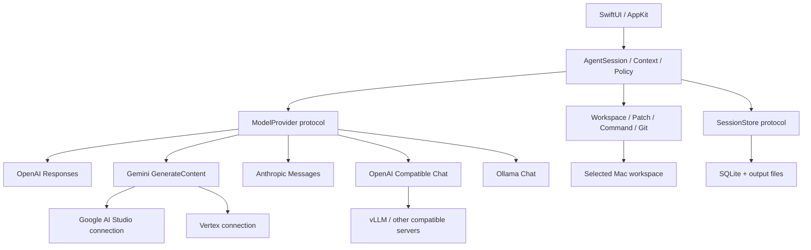

# Lathe 아키텍처 초안

작성: 2026-10-15. 구현 전 검토용이며, 아래 기술 선택은 확정 요구사항과 구분한다.

## 1. 목표와 범위

사용자의 프로젝트를 읽고, 변경을 제안·적용하고, 명령과 테스트를 실행하는 Swift 기반 macOS 코딩 에이전트다.

확정 요구사항:

- Swift 기반 macOS 네이티브 앱.
- 개인용으로 개발하고 GitHub로 제공. 기능 구현마다 검증 후 커밋하고 GitHub에 반영.
- OpenAI, Google AI Studio, Vertex AI, Anthropic Claude, vLLM, Ollama 및 기타 로컬 서빙 방식 지원.
- vLLM·Ollama 등의 서버 주소는 localhost, LAN, 외부 도메인 모두 지원.

초기 기술 선택 제안:

- macOS 15 이상, Swift 6 언어 모드, SwiftUI + 필요한 부분의 AppKit.
- GitHub 소스 빌드를 우선. 바이너리 릴리스가 필요할 때 서명·공증·업데이트를 설계.
- 한 작업 폴더에 동시에 실행되는 에이전트는 하나. 여러 세션을 저장하되 쓰기 경쟁을 먼저 방지.
- 모델 호출은 선택한 서버에서, 파일·Git·명령 실행은 선택한 Mac 작업 폴더에서 수행.
- 초기는 텍스트와 도구 호출 중심. 모델 설치·서버 시작·원격 SSH 실행·멀티 에이전트·MCP·완전한 IDE/PTY는 후속 범위.

최소 macOS 버전은 사용할 API와 테스트 범위를 결정한다. 최신 Xcode 버전과 최소 실행 OS 버전은 별개다.
원격 모델 서버의 OS/GPU 조건도 앱의 최소 버전과 별개다. 15 이상은 현재 제안이며 실제 사용할 Mac에 맞춰 조정할 수 있다.

## 2. 사용 흐름과 화면

프로젝트 열기 → 연결/모델 선택 → 요청 → 파일 탐색 → 변경 검토·적용 → 명령/테스트 → 결과와 diff 확인.

| 화면 | 역할 |
| --- | --- |
| 왼쪽 사이드바 | 프로젝트, 프로젝트별 세션, 실행 상태 |
| 중앙 대화 | 사용자 요청, 스트리밍 답변, 도구 실행 카드, 승인, 중지·재시도 |
| 오른쪽 상세 | 관련 파일, 변경 파일 목록, 읽기 전용 unified diff |
| 아래 실행 패널 | 명령, 작업 경로, stdout/stderr, 종료 코드 |
| 설정 | 연결 목록, 자격 증명, 모델 프로필, 연결 진단 |

SwiftUI로 창·탐색·설정을 구성하고, 코드·로그·diff는 필요할 때 AppKit 텍스트 뷰를 연결한다.
처음부터 자체 코드 에디터 전체를 만들기보다 파일 열기와 변경 검토를 완성한다.

## 3. 구성과 의존성



하나의 Xcode 앱과 하나의 로컬 Swift Package로 시작한다. 처음부터 여러 저장소나 서비스로 분할하지 않는다.

| 구성 | 책임 |
| --- | --- |
| `LatheApp` | SwiftUI/AppKit, ViewModel, 의존성 조립 |
| `LatheCore` | 도메인 타입, 실행 상태 머신, 컨텍스트·권한 정책, provider/tool/store 프로토콜 |
| `LatheProviders` | 인증, 엔드포인트 조립, HTTP, SSE/NDJSON, 각 API 변환 |
| `LatheWorkspace` | 파일 탐색·읽기, 패치, 명령 실행, Git 조회 |
| `LathePersistence` | SQLite 저장, 마이그레이션, 실행 기록·출력 파일 |

인프라 모듈은 Core에 의존한다. Core는 UI나 특정 제공자 DTO에 의존하지 않는다.
UI 상태만 `@MainActor`에서 갱신하고, `AgentSession` actor가 실행 상태를 소유한다.
네트워크와 프로세스 수명은 View 생성·소멸에 묶지 않는다.

## 4. 프로바이더 설계

서비스 이름, API 형식, 서버 위치, 모델 능력을 별도 개념으로 둔다.

| 사용자에게 보이는 연결 | 초기 API 어댑터 | 인증/설정 |
| --- | --- | --- |
| OpenAI | `OpenAIResponsesProvider` | API key, model ID |
| Google AI Studio | `GeminiGenerateContentProvider` | Gemini Developer API key, model ID |
| Vertex AI | 같은 Gemini codec + Vertex 연결 계층 | project, location, model ID, gcloud ADC token helper |
| Anthropic Claude | `AnthropicMessagesProvider` | API key, model ID, API version |
| vLLM | `OpenAICompatibleChatProvider` | 사용자 URL, 필요시 Bearer/custom header |
| Ollama | `OllamaChatProvider` | 사용자 URL, 필요시 proxy 인증 |
| 기타 서버 | 지원하는 API 형식으로 연결 | 사용자 URL, 인증, 모델·호환성 옵션 |

초기 구현은 다섯 가지 API 어댑터다. Vertex와 AI Studio의 endpoint/auth는 분리하되 Gemini 콘텐츠 변환을 공유한다.
vLLM은 Chat Completions 프리셋부터 검증하고 Responses 사용은 후속 호환성 검증을 거친다.
Ollama는 native `/api/chat`을 기본으로 하며, 일반 OpenAI-compatible 연결도 별도 선택할 수 있다.
기타 서버는 실제 제공하는 API가 호환될 때 기존 어댑터를 사용한다. 임의의 모델 런타임을 자동으로 지원한다고 표시하지 않는다.

Google의 Interactions와 GenerateContent는 다른 wire format이다. 초기에는 Vertex와 공유하기 쉬운 GenerateContent를 명시적으로 선택한다.
Interactions를 추가할 때 별도 API flavor와 codec을 둔다. Vertex Express 인증/경로 역시 standard Vertex와 구분한다.

개인용 Vertex 인증은 설치된 `gcloud`를 통해 ADC access token을 얻는 방식으로 시작한다.
사용자가 외부에서 ADC login을 완료하고, 앱은 인자 배열로 `gcloud auth application-default print-access-token`을 실행한다.
Swift에서 ADC 전체를 재구현하는 것은 아니다. 토큰은 메모리에만 두고 요청 시 획득하며 동시 획득을 합친다.
이전 캐시 토큰의 남은 수명을 임의로 1시간이라고 가정하지 않는다. gcloud는 Vertex 연결에만 필요한 선택 의존성이다.

### 연결과 모델 프로필

`ProviderConnection`:

- id, 표시 이름, 서비스 프리셋, API flavor.
- base URL과 경로 prefix. endpoint builder가 `/v1` 중복이나 프록시 prefix 소실을 방지.
- 인증 전략: none / Bearer / provider API-key header / custom headers / Vertex gcloud helper.
- 비밀 값은 Keychain 참조, 비밀이 아닌 설정은 로컬 저장.
- 연결·첫 응답·스트림 무응답 제한, 취소 정책.
- 사용자 지정 네트워크 전송 설정과 연결 설정 revision.

`ModelProfile`:

- connection ID, model ID, 표시 이름, context budget, 출력 한도.
- 도구 호출, 스트리밍, 병렬 호출, reasoning, structured output 등 capability.
- capability별 `unknown / verified / unsupported`, 근거, 확인 시점, 사용자 override.
- 해당 API가 지원하는 sampling/reasoning 옵션만 저장·전송.
- 실제 추론 위치에 대한 사용자 설명/확인 상태. URL만 보고 로컬 추론이라고 단정하지 않음.

모델 목록 조회 성공은 도구 호출 지원의 증거가 아니다. 연결 진단은 일반 응답, 스트리밍, 무해한 도구 호출과 결과 반환까지 단계별로 확인한다.
검증 결과는 URL·모델·설정 revision에 연결한다. 모든 모델의 코딩 능력이나 향후 서버 설정까지 보장하지 않는다.

### 외부 모델 서버

동일한 연결 타입으로 아래 형태를 처리한다. 주소는 예시다.

| 서버 | 예시 |
| --- | --- |
| Mac의 vLLM | `http://localhost:8000/v1` |
| LAN의 vLLM | `http://192.168.1.20:8000/v1` |
| 외부 vLLM 프록시 | `https://models.example.com/team-a/v1` |
| Mac의 Ollama | `http://localhost:11434` |
| 외부 Ollama 프록시 | `https://models.example.com/ollama` |

- 외부 연결은 HTTPS를 기본으로 한다. HTTP 개발/LAN 서버는 해당 연결에 명시적으로 설정할 수 있게 한다.
- 인증서는 시스템 신뢰 검증을 사용한다. 사설 CA는 OS 신뢰 설정으로 처리하며 전역 인증서 검증 해제는 제공하지 않는다.
- Bearer/custom header는 연결별로 저장한다. 다른 origin으로 redirect할 때 자격 증명을 전달하지 않는다.
- 역방향 프록시의 경로 prefix, 타임아웃, 스트리밍 buffering 영향을 연결 진단에서 드러낸다.
- 연결 실패, 인증 실패, 모델 없음, capability 오류, 첫 토큰 대기, 중간 스트림 단절을 구분한다.
- 연결이 끊기면 미완성 tool call은 실행하지 않는다. 도구 실행 이후 무작정 전체 turn을 재시도하지 않는다.
- provider 장애 때 다른 클라우드로 자동 전환하지 않는다. 사용자가 대상 연결을 선택한다.

모델 endpoint와 workspace executor를 서로 독립적으로 둔다. 외부 모델 서버 연결은 원격 파일 접근이나 원격 shell 실행을 의미하지 않는다.
Ollama localhost도 cloud 모델을 중계할 수 있으므로 `localhost == 모든 추론이 내 Mac`이라는 표시를 하지 않는다.

## 5. API 경계와 스트리밍

개념 인터페이스:

```swift
protocol ModelProvider: Sendable {
    func stream(_ request: ModelRequest) async throws
        -> AsyncThrowingStream<ModelEvent, Error>
}
```

`ModelEvent`는 text delta, tool-call assembly, usage, 정상 완료를 표현한다. 네트워크·프로토콜 실패는 typed error로 반환한다.
정상 완료에는 finish reason과 재전송에 필요한 provider continuation state가 포함된다.
스트림 종료와 정상 응답 완료를 구분하며, task 취소는 HTTP 요청 취소까지 전달한다.

- SSE와 NDJSON은 프레이밍 계층을 분리한다. UTF-8·JSON이 임의 byte 경계로 잘릴 수 있다.
- 도구 호출은 provider의 ID/index/block 기준으로 조립한다. 공통 ID가 없으면 어댑터가 매핑한다.
- 어댑터가 정상 완료를 확인한 호출만 JSON/schema 검증 후 실행 대상으로 넘긴다.
- 불완전한 JSON, 토큰 한도 종료, 연결 단절, 알 수 없는 tool은 파일 변경 전에 처리한다.
- UI용 텍스트와 다음 요청에 필요한 provider 원본 블록을 분리 저장한다.
- OpenAI reasoning items, Gemini thought signatures, Anthropic thinking/signature는 provider별 규칙에 맞게 원형 보존한다.
- provider 고유 상태는 다른 provider에 전달하지 않는다. UI에 노출할 요약과 opaque continuation 데이터를 구분한다.

provider/model 변경은 실행이 끝난 시점에 가능하게 한다. 다른 연결로 전환할 때 사용자·assistant 텍스트와 도구 결과·명시적 요약으로 새 실행 분기를 만들고,
출처와 전환 지점을 기록한다. 숨겨진 provider 상태를 단순 문자열로 변환해 전달하지 않는다.

## 6. 에이전트 실행과 도구

기본 루프: 요청 → 컨텍스트 구성 → 모델 응답 → 도구 검증·정책 판단 → 실행 → 결과를 모델에 반환 → 반복 → 최종 답변.

상태는 `idle`, `preparing`, `streaming`, `awaitingApproval`, `executingTools`, `completed`, `cancelled`, `failed`, `interrupted`를 명시한다.
turn별 최대 도구 반복 수, 실행 시간, 출력 크기, context budget을 둔다. 지원 확인 전 병렬 tool 호출을 가정하지 않는다.
MVP 도구 실행은 직렬로 시작한다.

| 도구 | 초기 동작 |
| --- | --- |
| `list_files` / `search_text` | 작업 폴더 검색, ignore 적용, 결과 한도 |
| `read_file` | 범위 읽기, 파일 크기 제한 |
| `apply_patch` | 변경 전 diff, 승인 정책, 기존 내용 검증 후 적용 |
| `run_command` | 실행 파일/인수 또는 명시적 shell mode, cwd, 제한 시간, 출력 |
| `git_status` / `git_diff` | 현재 변경을 읽고 사용자에게 표시 |

읽기는 선택한 작업 폴더와 명시적 허용 범위 안에서 수행한다. 패치·명령 승인은 도구·프로젝트·세션 범위로 표현하고 실행 기록에 남긴다.
경로 traversal과 symlink를 검증하고, 파일이 읽은 뒤 바뀌면 patch를 중단하고 다시 확인한다.
쓰기 전에 변경 전 내용/hash와 실행 intent를 기록한다. 여러 파일 패치 중 일부만 적용된 경우도 복구 기록에 남긴다.
자동 복원은 현재 파일이 에이전트가 기록한 적용 후 상태와 일치할 때만 허용한다.

명령 실행은 UI와 별도 `CommandExecutor` 뒤에 둔다. `Process`/POSIX 구현을 기본 후보로 하고 Swift Subprocess 도입은 구현 시 판단한다.
stdout/stderr를 함께 소비하고 출력은 한도를 두어 별도 파일로 저장한다. 취소·시간 초과 시 프로세스 그룹 종료를 구현·검증한다.
shell 명령은 임의 효과를 낼 수 있으므로 단순 명령 이름 allowlist를 격리 기능처럼 취급하지 않는다.
작업 경로와 앱 승인 정책은 OS sandbox가 아니다. 일반 코드 도구 실행을 위해 초기 GitHub 빌드는 App Sandbox를 사용하지 않는 방향으로 설계한다.

기존 사용자 변경을 시작 시 기록하고 에이전트 변경과 구분한다. 앱이 자동으로 stash/reset/commit/push하지 않는다.
Lathe 자체를 개발하면서 기능별 GitHub 커밋을 하는 작업 흐름은, 앱이 사용자 저장소를 자동 커밋하는 기능과 별개다.

## 7. 컨텍스트와 저장

초기는 파일 목록·검색·선택 범위 읽기로 컨텍스트를 수집한다. 임베딩 인덱스는 필요성이 확인되면 추가한다.
프로젝트 지침은 적용 위치와 출처를 추적한다. 도구 출력·파일 내용이 실행 권한 정책을 바꾸지는 않는다.
전체 저장소를 매번 전송하지 않고, 선택 내용·최근 대화·도구 결과를 예산 안에서 구성한다.
모델별 토큰 계산을 사용할 수 없는 경우 보수적 추정임을 표시한다. 오래된 대화는 요약하되 원본은 로컬에 보존한다.
컨텍스트 요약은 완료된 turn 경계에서 수행한다. 진행 중인 tool call·결과·서명 블록을 분리하거나 삭제하지 않는다.
전송 이력을 재구성할 때 continuation을 재사용할 수 있는지 어댑터가 판단하고, 호환되지 않으면 명시적 요약으로 새 실행 분기를 시작한다.

SQLite에 `Workspace`, `Session`, `Turn`, `Message`, `ToolCall`, `Approval`, `FileChange`, provider continuation을 저장한다.
DB 접근은 `SessionStore`로 추상화하고, 구현 시 SQLite wrapper를 고정한다. 대형 출력은 Application Support 아래 파일로 분리한다.
API key·인증 header 값은 Keychain, access token은 메모리, UI 설정은 UserDefaults에 둔다.
일반 진단 로그에는 원문 코드·대화·비밀을 기본 기록하지 않는다.

도구 실행 전 intent와 완료 후 결과를 기록한다. 앱 재시작 시 진행 중 작업은 `interrupted`로 복원한다.
완료 여부가 불명확한 shell 작업은 자동 재실행하지 않는다. 이 기록은 임의 shell 명령의 exactly-once 실행을 보장하지 않는다.

## 8. 근거와 구현 시 재확인할 사항

아래는 2026-10-15에 확인한 공식 문서다. API 버전·모델 기능은 실제 어댑터 구현 시 다시 검증한다.

- [OpenAI streaming](https://developers.openai.com/api/docs/guides/streaming-responses): SSE와 의미별 이벤트.
- [OpenAI function calling](https://developers.openai.com/api/docs/guides/function-calling), [reasoning](https://developers.openai.com/api/docs/guides/reasoning): 도구 결과 왕복과 재전송 상태.
- [Gemini GenerateContent](https://ai.google.dev/api/generate-content), [Interactions streaming](https://ai.google.dev/gemini-api/docs/streaming): 서로 다른 API 형식.
- [Gemini thought signatures](https://ai.google.dev/gemini-api/docs/generate-content/thought-signatures): opaque part 상태 보존.
- [Google REST 인증](https://docs.cloud.google.com/docs/authentication/rest), [gcloud ADC token](https://docs.cloud.google.com/sdk/gcloud/reference/auth/application-default/print-access-token): Vertex 인증 helper의 근거.
- [Vertex function calling](https://docs.cloud.google.com/gemini-enterprise-agent-platform/models/tools/function-calling): Gemini tool 형식.
- [Anthropic streaming](https://platform.claude.com/docs/en/build-with-claude/streaming), [tool results](https://platform.claude.com/docs/en/agents-and-tools/tool-use/handle-tool-calls), [thinking](https://platform.claude.com/docs/en/build-with-claude/thinking): block stream·tool 결과·서명 보존.
- [vLLM API](https://docs.vllm.ai/en/stable/serving/online_serving/openai_compatible_server/), [tool calling](https://docs.vllm.ai/en/stable/features/tool_calling/): 호환 범위와 서버/parser 설정.
- [vllm-metal](https://github.com/vllm-project/vllm-metal): Mac 추론 런타임도 가능하며 설치/운영은 앱 연결과 별도 범위.
- [Ollama chat](https://docs.ollama.com/api/chat), [streaming](https://docs.ollama.com/api/streaming), [authentication](https://docs.ollama.com/api/authentication): NDJSON, native API, localhost와 실제 추론 위치의 차이.
- [Apple AppKit bridge](https://developer.apple.com/documentation/swiftui/nsviewrepresentable), [Keychain](https://developer.apple.com/documentation/security/keychain-services): 네이티브 UI와 자격 증명 저장.
